# Beans Disease Classification API — MLOps CI/CD Pipeline

[](https://github.com/<your-username>/beans-api-mlops-cicd/actions/workflows/ci.yml)


An end-to-end **MLOps CI/CD pipeline** for a machine learning API that classifies bean-leaf diseases from images using a Vision Transformer (`nateraw/vit-base-beans`). Every push to `main` automatically **lints** the code, **validates the model and data** with Deepchecks, **builds** a Docker image, **pushes** it to Amazon ECR, and **deploys** it to AWS ECS Fargate, with no manual steps.

---

## Table of Contents

- [Overview](#-overview)
- [Architecture](#-architecture)
- [Pipeline Stages](#-pipeline-stages)
- [Repository Structure](#-repository-structure)
- [Tech Stack](#-tech-stack)
- [API Reference](#-api-reference)
- [Getting Started](#-getting-started)
- [Configuration & Secrets](#-configuration--secrets)
- [Model Quality Gate](#-model-quality-gate)
- [Load Testing](#-load-testing)
- [Troubleshooting](#-troubleshooting)
- [Roadmap](#-roadmap)

---

## Overview

Before this pipeline, every change required a developer to manually run tests, build a container, push it to a registry, and deploy it to the cloud. That process was slow, inconsistent, and error-prone.

This project replaces it with a single GitHub Actions workflow that provides:

| Capability | Implementation |
|---|---|
| **Code quality** | [Ruff](https://docs.astral.sh/ruff/) linting on `main.py` and `quality_check.py` |
| **Model & data validation** | [Deepchecks](https://deepchecks.com/) vision `train_test_validation` suite with a label-drift gate |
| **Containerization** | Docker image built from `python:3.12-slim` |
| **Immutable versioning** | Tags of the form `<commit-sha-8>-<unix-timestamp>`, plus a moving `:latest` |
| **Registry** | Amazon ECR |
| **Deployment** | Amazon ECS on Fargate, with `wait-for-service-stability` |
| **Fast feedback** | `pip` and HuggingFace caches keyed on dependency/model identity |

---

## Architecture

The diagram below shows the full data science flow: from the data and model sources, through the quality gate, to the container image and the live service. Each group has its own color palette.

```mermaid
flowchart LR

    %% ---------- Developer ----------
    subgraph DEV[" DEVELOPER WORKFLOW"]
        direction TB
        D1["Write / update code<br/>main.py · quality_check.py"]
        D2["git commit & push<br/>branch: main"]
        D1 --> D2
    end

    %% ---------- Data & Model Sources ----------
    subgraph SRC[" DATA & MODEL SOURCES (HuggingFace Hub)"]
        direction TB
        S1[(" beans dataset<br/>train / validation / test")]
        S2["🧠 nateraw/vit-base-beans<br/>ViT image classifier"]
    end

    %% ---------- CI ----------
    subgraph CI[" GITHUB ACTIONS: CONTINUOUS INTEGRATION"]
        direction TB
        subgraph LINT["Stage 1 · Lint"]
            direction TB
            L1["Set up Python 3.12"]
            L2["ruff check<br/>main.py quality_check.py"]
            L1 --> L2
        end
        subgraph QC["Stage 2 · Quality Check"]
            direction TB
            Q1["Restore pip +<br/>HuggingFace caches"]
            Q2["Install<br/>requirements-quality.txt"]
            Q3["Run quality_check.py<br/>Deepchecks train_test_validation"]
            Q4{"Label drift<br/>score ≤ 0.5 ?"}
            Q1 --> Q2 --> Q3 --> Q4
        end
        L2 --> Q1
    end

    %% ---------- Build ----------
    subgraph CD1[" GITHUB ACTIONS: BUILD & PUBLISH"]
        direction TB
        B1["Configure AWS credentials<br/>(GitHub Secrets)"]
        B2["Login to Amazon ECR"]
        B3["docker build<br/>tag: sha8-timestamp"]
        B4["docker push<br/>versioned tag + :latest"]
        B1 --> B2 --> B3 --> B4
    end

    %% ---------- Registry ----------
    subgraph REG[" CONTAINER REGISTRY"]
        direction TB
        R1[("Amazon ECR<br/>beans-api")]
    end

    %% ---------- Deploy ----------
    subgraph CD2[" GITHUB ACTIONS: DEPLOY"]
        direction TB
        P1["Download current<br/>ECS task definition"]
        P2["Render task definition<br/>with new image"]
        P3["Deploy to ECS service<br/>wait for stability"]
        P1 --> P2 --> P3
    end

    %% ---------- Runtime ----------
    subgraph PROD[" PRODUCTION · AWS ECS FARGATE"]
        direction TB
        E1["ECS Cluster<br/>beans-api-cluster"]
        E2["ECS Service<br/>beans-api-service"]
        E3["FastAPI container :8000<br/>POST /predict · GET /health"]
        E4[("CloudWatch Logs<br/>/ecs/beans-api")]
        E1 --> E2 --> E3
        E3 -.-> E4
    end

    %% ---------- Consumers ----------
    subgraph USE[" CONSUMERS & VALIDATION"]
        direction TB
        U1["Client applications<br/>HTTP / JSON"]
        U2["Locust load tests<br/>locustfile.py"]
    end

    %% ---------- Flow ----------
    D2 ==>|"triggers workflow"| L1
    S1 -.->|"load_dataset"| Q3
    S2 -.->|"pipeline()"| Q3
    Q4 ==>|" pass"| B1
    Q4 -.->|"❌ fail: pipeline stops"| STOP(["⛔ Deployment blocked"])
    B4 ==> R1
    R1 ==>|"pull :latest"| P2
    P3 ==> E1
    E3 ==>|"predictions"| U1
    U2 -.->|"stress test"| E3

    %% ---------- Group (subgraph) colors ----------
    style DEV  fill:#E3F2FD,stroke:#1565C0,stroke-width:3px,color:#0D47A1
    style SRC  fill:#FFF8E1,stroke:#F9A825,stroke-width:3px,color:#8D6E00
    style CI   fill:#F3E5F5,stroke:#6A1B9A,stroke-width:3px,color:#4A148C
    style LINT fill:#EDE7F6,stroke:#5E35B1,stroke-width:2px,color:#311B92
    style QC   fill:#FCE4EC,stroke:#C2185B,stroke-width:2px,color:#880E4F
    style CD1  fill:#E0F7FA,stroke:#00838F,stroke-width:3px,color:#006064
    style REG  fill:#FFF3E0,stroke:#EF6C00,stroke-width:3px,color:#E65100
    style CD2  fill:#E8F5E9,stroke:#2E7D32,stroke-width:3px,color:#1B5E20
    style PROD fill:#FFEBEE,stroke:#C62828,stroke-width:3px,color:#B71C1C
    style USE  fill:#ECEFF1,stroke:#37474F,stroke-width:3px,color:#263238

    %% ---------- Node colors ----------
    style D1 fill:#90CAF9,stroke:#1565C0,color:#0D47A1
    style D2 fill:#64B5F6,stroke:#0D47A1,color:#0D47A1

    style S1 fill:#FFE082,stroke:#F9A825,color:#5D4300
    style S2 fill:#FFD54F,stroke:#F57F17,color:#5D4300

    style L1 fill:#B39DDB,stroke:#5E35B1,color:#1A0A4A
    style L2 fill:#9575CD,stroke:#4527A0,color:#FFFFFF

    style Q1 fill:#F8BBD0,stroke:#C2185B,color:#5A0A2E
    style Q2 fill:#F48FB1,stroke:#AD1457,color:#5A0A2E
    style Q3 fill:#F06292,stroke:#880E4F,color:#FFFFFF
    style Q4 fill:#EC407A,stroke:#880E4F,color:#FFFFFF

    style B1 fill:#B2EBF2,stroke:#00838F,color:#00363A
    style B2 fill:#80DEEA,stroke:#00838F,color:#00363A
    style B3 fill:#4DD0E1,stroke:#006064,color:#00363A
    style B4 fill:#26C6DA,stroke:#006064,color:#00363A

    style R1 fill:#FFCC80,stroke:#E65100,color:#5C2A00

    style P1 fill:#C8E6C9,stroke:#2E7D32,color:#0B3D0E
    style P2 fill:#A5D6A7,stroke:#2E7D32,color:#0B3D0E
    style P3 fill:#81C784,stroke:#1B5E20,color:#0B3D0E

    style E1 fill:#FFCDD2,stroke:#C62828,color:#5E0F0F
    style E2 fill:#EF9A9A,stroke:#C62828,color:#5E0F0F
    style E3 fill:#E57373,stroke:#B71C1C,color:#FFFFFF
    style E4 fill:#EF5350,stroke:#B71C1C,color:#FFFFFF

    style U1 fill:#CFD8DC,stroke:#37474F,color:#1C2A30
    style U2 fill:#B0BEC5,stroke:#37474F,color:#1C2A30

    style STOP fill:#212121,stroke:#000000,color:#FFFFFF,stroke-width:2px
```



**Legend:**
 Developer ·  Data & model sources ·  Lint ·  Quality gate ·  Build & publish ·  Registry ·  Deploy ·  Production runtime ·  Consumers / blocked path

---

## Pipeline Stages

The workflow lives in `.github/workflows/ci.yml` and runs on every **push to `main`**. Jobs are chained with `needs:` so a failure at any stage stops everything downstream.

```
lint ──► quality-check ──► build ──► deploy
```

| # | Job | Purpose | Key details |
|---|-----|---------|-------------|
| 1 | **`lint`** | Enforce code quality | Python 3.12, `pip install ruff`, `ruff check main.py quality_check.py` |
| 2 | **`quality-check`** | Validate model & data | Caches `~/.cache/pip` (keyed by `hashFiles('requirements-quality.txt')`) and `~/.cache/huggingface` (key `hf-beans-vit`); runs `python quality_check.py` |
| 3 | **`build`** | Build & publish image | Configures AWS credentials, logs in to ECR, builds the image, pushes `<sha8>-<timestamp>` and `:latest` |
| 4 | **`deploy`** | Roll out to ECS | Downloads the live task definition, renders it with the new image, deploys, and waits for service stability |

**Image tagging.** Each build is tagged `${GITHUB_SHA:0:8}-$(date +%s)` (for example `abc12345-1714000000`), which makes every release traceable to a commit and a point in time. The `:latest` tag always points at the most recent successful build.

**Registry URI.** The ECR registry is read from the `ECR_REGISTRY` secret and never hard-coded.

---

## Repository Structure

```
beans-api-mlops-cicd/
├── .github/
│   └── workflows/
│       └── ci.yml                  # CI/CD pipeline definition
├── Dockerfile                      # Container image for the API
├── main.py                         # FastAPI application
├── quality_check.py                # Deepchecks model/data quality gate
├── locustfile.py                   # Load-test scenarios
├── requirements.txt                # Runtime dependencies (API image)
├── requirements-quality.txt        # CI-only dependencies (quality gate)
└── README.md
```

> **Note:** `cicd-steps.md`, `setup-prerequisites.sh`, and `task-definition.json` are local setup helpers and are intentionally **not** committed to the repository.

---

## Tech Stack

| Layer | Tools |
|---|---|
| **API** | FastAPI 0.110, Uvicorn 0.27, python-multipart |
| **ML / inference** | Transformers `image-classification` pipeline (ViT), PyTorch, Pillow |
| **Model validation** | Deepchecks (vision), PyTorch, torchvision, PyTorch Ignite, Transformers, Datasets, scikit-learn, NumPy |
| **Linting** | Ruff |
| **Containers** | Docker (`python:3.12-slim`) |
| **CI/CD** | GitHub Actions |
| **Cloud** | AWS ECR, ECS Fargate, CloudWatch Logs, IAM |
| **Load testing** | Locust |

---

## API Reference

The service listens on port **8000**.

### `GET /health`

Liveness check that also reports the model being served. Suitable for load-balancer or uptime probes.

```bash
curl http://<host>:8000/health
```
```json
{ "status": "healthy", "model": "nateraw/vit-base-beans" }
```

### `POST /predict`

Accepts an image upload (`multipart/form-data`, field name `file`) and returns the top predicted bean-leaf class with its confidence score.

```bash
curl -X POST http://<host>:8000/predict \
  -F "file=@leaf.jpg;type=image/jpeg"
```
```json
{ "label": "angular_leaf_spot", "score": 0.98 }
```

The model predicts one of three classes: `angular_leaf_spot`, `bean_rust`, or `healthy`.

| Status | Meaning |
|---|---|
| `200` | Prediction returned |
| `400` | Uploaded file's content type is not `image/*` |
| `422` | Missing `file` field |

Interactive docs are served by FastAPI at `/docs` (Swagger UI) and `/redoc`.

---

## Getting Started

### Prerequisites

- Python 3.12+
- Docker
- Git and the [GitHub CLI](https://cli.github.com/) (`gh`)
- An AWS account with permissions for ECR, ECS, IAM, and CloudWatch
- AWS CLI configured with valid credentials

### 1. Clone the repository

```bash
git clone https://github.com/<your-username>/beans-api-mlops-cicd.git
cd beans-api-mlops-cicd
```

### 2. Run the API locally

```bash
python -m venv .venv
source .venv/bin/activate          # Windows: .venv\Scripts\activate
pip install -r requirements.txt

uvicorn main:app --reload --port 8000
```

Open <http://localhost:8000/docs> to try the endpoints. The first start downloads the model from HuggingFace, so it may take a moment.

### 3. Run with Docker

```bash
docker build -t beans-api .
docker run --rm -p 8000:8000 beans-api
```

### 4. Run the quality gate locally

```bash
pip install -r requirements-quality.txt
python quality_check.py
```

The first run downloads the model and dataset from HuggingFace; later runs use the local cache.

### 5. Lint locally

```bash
pip install ruff
ruff check main.py quality_check.py
```

### 6. Enable the pipeline

1. Make sure `ci.yml` is located at `.github/workflows/ci.yml`:

   ```bash
   mkdir -p .github/workflows
   mv ci.yml .github/workflows/ci.yml
   ```

2. Provision the AWS resources the workflow expects: an ECR repository, an ECS cluster, a Fargate task definition, and a service (names are listed below).
3. Add the repository secrets (see next section).
4. Push to `main`:

   ```bash
   git add .
   git commit -m "Add CI/CD pipeline"
   git push origin main
   ```

5. Watch the run under the **Actions** tab of your repository.

---

## Configuration & Secrets

### Repository secrets

Set these with the GitHub CLI (or under *Settings → Secrets and variables → Actions*):

```bash
gh secret set AWS_ACCESS_KEY_ID     -b "<value>"
gh secret set AWS_SECRET_ACCESS_KEY -b "<value>"
gh secret set AWS_SESSION_TOKEN     -b "<value>"
gh secret set AWS_REGION            -b "us-east-1"
gh secret set ECR_REGISTRY          -b "<account-id>.dkr.ecr.<region>.amazonaws.com"
```

| Secret | Description |
|---|---|
| `AWS_ACCESS_KEY_ID` | AWS access key |
| `AWS_SECRET_ACCESS_KEY` | AWS secret key |
| `AWS_SESSION_TOKEN` | Session token (required for temporary credentials, e.g. lab or SSO accounts) |
| `AWS_REGION` | AWS region of your resources |
| `ECR_REGISTRY` | ECR registry host, without the repository name |

> Never commit credentials. Temporary credentials expire, so refresh the secrets when they do.

### Workflow environment variables

Defined at the top of `ci.yml`:

| Variable | Value |
|---|---|
| `ECR_REPOSITORY` | `beans-api` |
| `TASK_DEFINITION` | `beans-api` |
| `CONTAINER_NAME` | `beans-api` |
| `ECS_SERVICE` | `beans-api-service` |
| `ECS_CLUSTER` | `beans-api-cluster` |

### AWS resources

| Resource | Name / setting |
|---|---|
| ECR repository | `beans-api` |
| ECS cluster | `beans-api-cluster` |
| ECS service | `beans-api-service` (Fargate) |
| Task definition family | `beans-api` (2 vCPU, 4 GB, `awsvpc`) |
| Container port | `8000/tcp` (open in the security group) |
| Log group | `/ecs/beans-api` |
| Task execution role | `ecsTaskExecutionRole` |

---

## Model Quality Gate

`quality_check.py` acts as a gate between CI and deployment:

1. Loads the **`nateraw/vit-base-beans`** image-classification pipeline from HuggingFace.
2. Loads the **`beans`** dataset (`train` and `test` splits) and wraps each as a Deepchecks `VisionData` object (batch size 8).
3. Runs the Deepchecks **`train_test_validation`** suite (up to 500 samples).
4. Inspects the **Label Drift** check, and **fails the build** (`exit 1`) if the drift score exceeds **0.5**.

A failing gate stops the workflow before any image is built or deployed.

---

## Load Testing

[Locust](https://locust.io/) is used to stress-test a running deployment.

```bash
pip install locust
locust -f locustfile.py --host http://<host>:8000
```

Then open <http://localhost:8089> to configure users and spawn rate.

> `locustfile.py` uploads a local `test.jpg` as multipart form data (field `file`) to `/predict`, matching the API contract above. Place a sample bean-leaf image named `test.jpg` in the working directory before running.

---

## Troubleshooting

| Symptom | Likely cause / fix |
|---|---|
| Workflow does not start | `ci.yml` must be at `.github/workflows/ci.yml` and the push must target `main` |
| `Credentials could not be loaded` | A secret is missing or expired; re-set the `AWS_*` secrets |
| ECR login or push denied | Check `ECR_REGISTRY` format and that the `beans-api` repository exists in the same region |
| `describe-task-definition` fails | The task definition family `beans-api` has not been registered yet |
| Deploy step times out | Check ECS service events and the `/ecs/beans-api` CloudWatch logs; confirm the container starts and port 8000 is reachable |
| Quality check is slow | Expected on a cold cache (large model and dataset downloads); subsequent runs reuse the caches |
| Container slow to become healthy | The model is downloaded on first start; allow time in the ECS health grace period |
| `ruff` failures | Run `ruff check main.py quality_check.py` locally and fix reported issues |

---

## Roadmap

- Run API tests (e.g. `pytest` against `/health` and `/predict`) as a pipeline stage
- Authenticate to AWS with GitHub OIDC instead of long-lived keys
- Add Trivy/Docker image vulnerability scanning
- Add a pull-request trigger that runs lint and quality checks without deploying
- Add Docker layer caching to speed up builds
- Bake the model weights into the Docker image to avoid a download at container start

---

## License

Add a license of your choice (e.g. MIT) before publishing.
